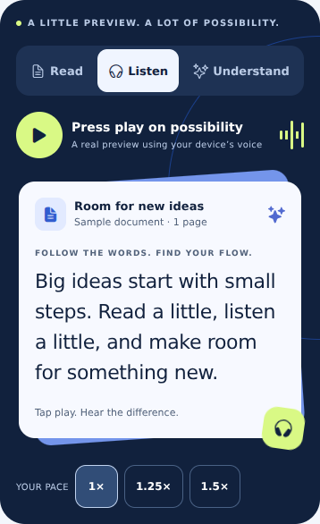

# Votic's subscription screen

The paywall branches from `fix/library-import-release-safeguards` at `b5b282c`. It is kept short, in this order:

1. **Headline:** follows the account's saved purpose, with a general reading outcome when no purpose is selected.
2. **Preview:** Read / Listen / Understand tabs on one clearly labelled sample page. The sample page, its question and its example answer also follow the saved purpose (study notes, a team update, or a short story). Listen plays actual device speech with available English voices and local speed controls, and offers **Your text**: the visitor pastes or types up to 500 characters and hears it read with word highlighting. That text stays in the screen's memory only; it is never saved, uploaded or sent to a model. Understand reveals an explicitly labelled example answer and makes no model request.
3. **Benefits:** three, with the complete list behind "See everything included".
4. **Plans:** store-backed billing cards (trial noted as "Includes a 2-week free trial"; the full "then $x" sentence appears once, above the button), a selected-offer trial timeline, full billing terms, closed subscription questions, and the persistent purchase action. Weekly, monthly, annual and other periods appear only when returned by the current RevenueCat offering. Annual savings compare a numeric annual price with 12 monthly payments in the same currency. Missing or ambiguous comparisons have no badge.

After the store confirms a purchase or a restore, a short welcome plays ("You're in." / "Welcome back."), announced to screen readers: the V from the welcome screen appears and its pieces fly off, then Votic opens. With Less motion the V stays still for a moment instead. Votic always opens within about 2.6 seconds, even if the animation is interrupted.

## Motion and audio

The preview is visible immediately; changing tabs brings the sample card into place with a short lift and rotation. Audio activity moves only during playback. Highlighting follows speech-engine boundary events, not an invented timer. Engines without word boundaries still play the sample without pretending to track words. Reduced motion removes the card transition, moving activity and advancing word highlights. No audio autoplays. Checkout, restore, changing tabs/voices/speed, backgrounding, blur and unmount stop owned preview audio. Delayed callbacks cannot revive a stopped sample.

The preview uses device text-to-speech, as the reader currently does. It is not a recording of an unavailable premium cloud voice. The selected preview speed and voice do not overwrite saved reader preferences.

## Store configuration and subsequent work

The implementation retains the current verified Premium entitlement and the existing Firebase/RevenueCat purchase flow. It does not create or price products in App Store Connect, Google Play Console or RevenueCat.

- To show additional billing periods, attach their real products to the current offering and the existing entitlement, validate store eligibility, then test purchases on native store builds. All displayed prices/trials come from those products. One membership is shown even when only one billing option is available.
- **Plus and Pro are not live in this change.** They need final usage allowances, real store products, verified server tier identification, and matching server enforcement. Both should share features; the future tier selector should compare allowances separately from billing periods. Product IDs and limits must not be inferred from client labels or trusted client claims.
- **Trial reminders are not enabled.** The timeline promises access and billing dates only. Add a reminder option only with permission-aware native scheduling, the verified trial expiry and cancellation/account-switch cleanup.
- **Testimonials/ratings are not fabricated.** Add only attributable feedback or verified store ratings when available.
- **A/B assignment and conversion analytics are not added.** First test the current design against this preview using stable assignments and a consistent eligible-user denominator. Measure paid conversion, revenue after speech/AI costs, refunds and renewal; let trials mature before comparing outcomes. A new weekly product, trial length or pricing change is a separate experiment, not a silent consequence of the UI update.

## Validation

Run mobile typecheck/lint, Vitest and Jest. Native store testing still needs a signed build with real configured products; web/Expo Go cannot validate billing or native device voice quality. The browser preview exercises the real React Native Web layout with development access, never a production purchase bypass.

Verified locally: TypeScript and ESLint passed; 363 Vitest tests and 428 Jest component/integration tests passed. React Native Web was inspected at 320, 390 and 768 pixels wide with no horizontal page overflow, including tab switching, the example answer, disclosure controls, the jump to plans and dark appearance. The voice sample play control is visible without scrolling at 390 × 844. Real native speech and store purchases still require device verification.

