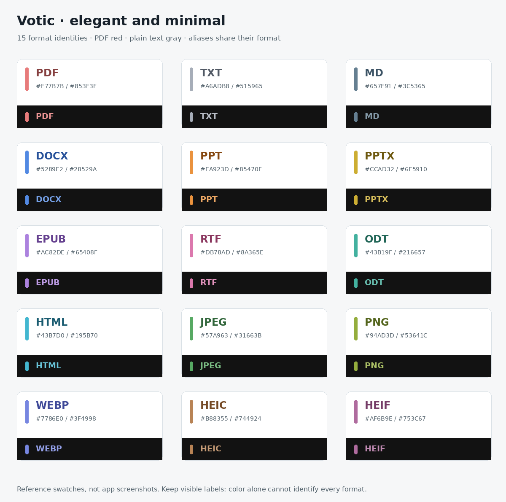

# Minimal document previews

Approved direction: elegant and minimal. One shared color identity per supported format across document cards, file icons and source notes. PDF remains red; TXT remains gray. `.jpg`/`.jpeg` and `.htm`/`.html` are aliases, not separate formats. Legacy `.doc` remains display-only.

| Format | Accent | Ink on white paper |
| --- | --- | --- |
| PDF | #E77B7B | #853F3F |
| TXT | #A6ADB8 | #515965 |
| MD | #657F91 | #3C5365 |
| DOCX | #5289E2 | #28529A |
| PPT | #EA923D | #85470F |
| PPTX | #CCAD32 | #6E5910 |
| EPUB | #AC82DE | #65408F |
| RTF | #DB78AD | #8A365E |
| ODT | #43B19F | #216657 |
| HTML | #43B7D0 | #195B70 |
| JPEG | #57A963 | #31663B |
| PNG | #94AD3D | #53641C |
| WEBP | #7786E0 | #3F4998 |
| HEIC | #B88355 | #744924 |
| HEIF | #AF6B9E | #753C67 |

White document paper and dark body text stay the same in both app themes. At small list sizes the extension remains visible without miniature body text. Color is an additional cue, not a substitute for the label.

This change implements the minimal frame around the existing retained content, explicitly labeled “Text excerpt · reflowed”. It removes decorative folds/spines and uses an honest empty-preview fallback. Saved-position previews are unchanged. Local first-page and image-thumbnail generation and account-scoped caching remain separate implementation work described in the earlier design review. No new file retention, preview uploads, services or billing are introduced.

Validation: TypeScript, changed-file ESLint, 68 file-identity tests and targeted component suites. Reference swatches are generated from the implementation palette, not emulator screenshots.
